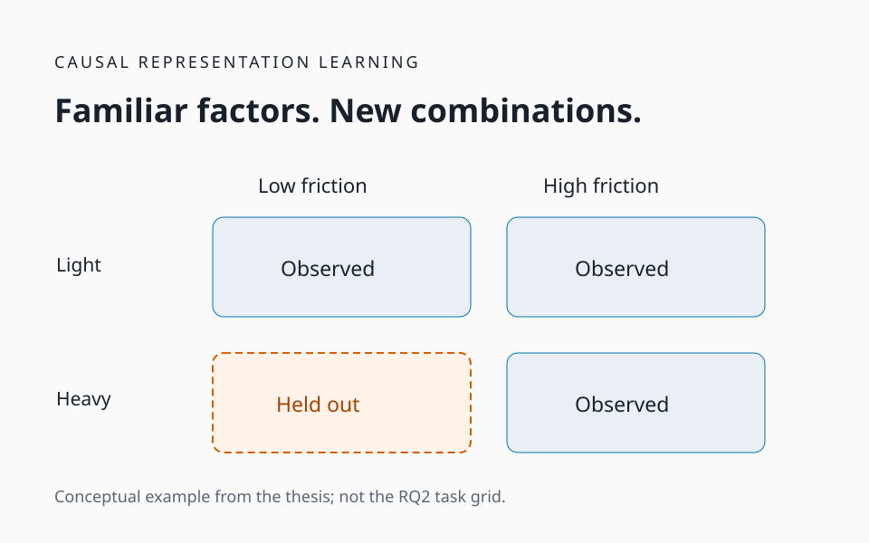

<header class="hero">

Markus Köfler · Machine learning &amp; causal representation learning

# Discovering structure. Learning what can be shared.

I study how learning agents discover shared structure across environments and reuse it in unfamiliar combinations.

<a class="button primary" href="research/">Explore my thesis research</a><a class="button" href="/cv/">CV &amp; experience</a><a class="button" href="mailto:markus.koefler11@gmail.com">Get in touch</a>

My completed MSc thesis at TU Wien examines active discovery of hidden task factors and the role of consistent representations in compositional generalization.

</header>

<section class="section">

Featured research · MSc thesis

## Different tasks. Shared properties.

A robot may have encountered a heavy body and a slippery floor separately, but never together. What structure would let it reuse that experience?

My thesis introduces Saturated Sequential Residualization (SSR) to discover which environments share hidden factor values. Separate decoder and control studies examine the usefulness of consistently organized task codes.

<a class="button primary" href="research/">Read the research report →</a>

<figure><figcaption>Conceptual example: familiar properties can meet in an unfamiliar combination.</figcaption></figure>

</section>

<article>
Discover
<strong>39 / 40</strong>
Exact global factor recovery with SSR across four locomotion families. Recursive CC recovered every factor in 1 of 40 runs.
</article>
<article>
Decode
<strong>99.89%</strong>
Exact held-out composition accuracy with aligned supplied codes and 64 training tasks, versus 4.26% with branch-local label permutations.
</article>
<article>
Control
<strong>4 families</strong>
Aligned supplied codes had the highest mean held-out AUC and final return under the tested SAC protocol.
</article>

These are separate studies. Downstream learners receive supplied codes; the thesis does not evaluate an end-to-end discovery-to-control pipeline.

<section class="section">

## More work

<article>

Medical imaging

<h3>Automatic markers for amyloidosis quantification</h3>

Automated feature-extraction pipelines for 3D SPECT scans using deep learning.

<a href="/research/">Research entries and publication links →</a>
</article>
<article>

Applied data science

<h3>From raw data to an inspectable analysis</h3>

Projects in medical imaging, classification, time-series modelling, and exploratory data analysis.

<a href="/projects/">Browse projects →</a>
</article>

</section>

<section class="section">

## About my work

My interests connect causal representation learning, reinforcement learning, and the practical question of which knowledge a learner can reuse. My background spans data science, quantitative economics, and applied machine learning.

I completed my MSc thesis in Data Science at TU Wien. Earlier, I studied International Business and Economics at the University of Klagenfurt and spent an exchange at the University of Illinois Urbana-Champaign.

<a href="/cv/">View my CV</a> · <a href="https://github.com/MarkusStefan">GitHub</a> · <a href="https://www.linkedin.com/in/markus-k%C3%B6fler/">LinkedIn</a>

</section>
