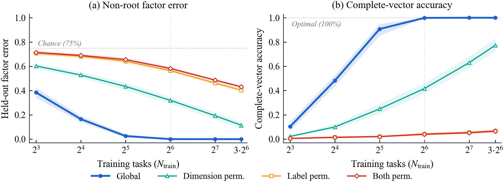
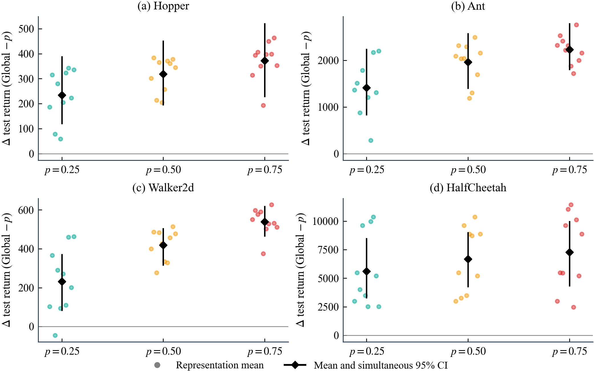
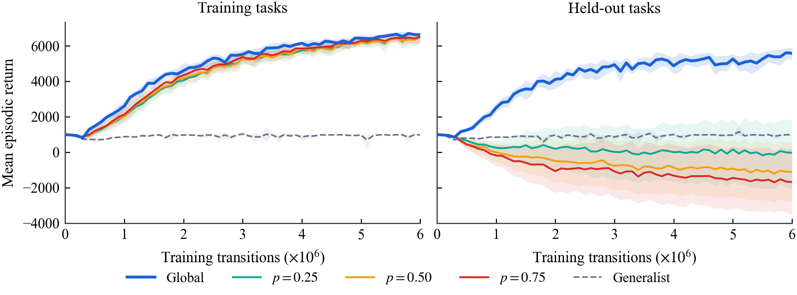

<header class="hero">

MSc thesis · Markus Köfler · Research report

# Discovering shared factors for compositional reinforcement learning

An agent can distinguish every task and still miss which properties those tasks share. This thesis studies how to discover those relationships—and whether consistent task codes help learners handle unfamiliar combinations.

Based on the completed MSc thesis, <em>Discovering Globally Aligned Representations through Causal Curiosity-Guided Exploration</em>, TU Wien. Report draft · 29 October 2026.

</header>

<article>
Discovery
<strong>39 of 40</strong>
SSR runs recovered every factor exactly, compared with 1 of 40 for recursive Causal Curiosity, across four locomotion families.
</article>
<article>
Decoding
<strong>99.89% / 4.26%</strong>
Exact held-out composition accuracy with globally aligned versus branch-local label-permuted codes, using 64 training tasks.
</article>
<article>
Control
<strong>4 task families</strong>
Globally aligned supplied codes achieved the highest mean held-out AUC and final return in every family.
</article>

<nav class="toc" aria-label="Report sections">
<a href="#question">The question</a><a href="#method">The method</a><a href="#discovery">Discovery</a><a href="#decoding">Decoding</a><a href="#control">Control</a><a href="#limits">Limits</a>
</nav>

<section class="section" id="question">

## Familiar properties, unfamiliar combinations

Consider a hypothetical robot that has walked with a light body on both slippery and high-friction floors, but with a heavy body only on the high-friction floor. Walking with the heavy body on the slippery floor requires combining familiar conditions in an unseen way.

A useful task representation records which environments share a body mass, surface friction, or goal. We call these factor-wise relationships a **sharing map**. The numeric labels are arbitrary; their meanings must be consistent across environments.

Causal Curiosity (CC) searches for action sequences that make hidden differences visible in trajectory responses [1]. It then repeats the search independently inside each discovered group. Those branches can assign opposite labels to the same property, or discover the remaining factors in different orders. The full code can still identify the task while its individual coordinates lose a common meaning.

<h3>Same task information. Different coordinate meanings.</h3>

Conceptual illustration using hypothetical mass and friction categories. It shows code assignments, without simulating or predicting a learner's performance.

<button class="button" type="button" data-mode="global" aria-pressed="true">Globally aligned</button>
<button class="button" type="button" data-mode="local" aria-pressed="false">Branch-local labels</button>

<strong>Light body · Low friction</strong>Code: (1, 1)

<strong>Light body · High friction</strong>Code: (1, 2)

<strong>Heavy body · Low friction</strong>Code: (2, 1)

<strong>Heavy body · High friction</strong>Code: (2, 2)

Global labels: the second label 1 means low friction for both bodies, and label 2 means high friction. All four complete codes identify different tasks.

<noscript>
The static view shows globally aligned labels. Under branch-local labels, the heavy-body codes become (2, 2) for low friction and (2, 1) for high friction.
</noscript>

</section>

<section class="section" id="method">

## One population-wide search at every stage

**Saturated Sequential Residualization (SSR)** keeps all environments in one search. Before discovering another factor, it subtracts response means within groups defined by earlier discoveries. It then clusters the residual responses globally, giving the new coordinate one common label assignment.

<ol class="steps">
<li><strong>Probe</strong>Apply the same candidate action sequence across the environment family and record responses.</li>
<li><strong>Group</strong>Collect environments with the same joint labels for previously discovered factors.</li>
<li><strong>Subtract</strong>Center each response using its group's mean, removing variation constant within that group.</li>
<li><strong>Cluster globally</strong>Fit one partition to the residuals across all environments. Search for experiments that separate the groups.</li>
</ol>

If the earlier partitions are correct, within-group subtraction removes main effects and interactions involving only those recovered factors. Effects involving an undiscovered factor can remain. Global fitting therefore creates a shared assignment, but does not guarantee that this assignment isolates a physical factor.

Discovery receives the number of transition and reward factors and their discrete cardinalities. Hidden parameter values and their sharing relations are withheld. Transition factors are searched before reward factors; reward responses can distinguish tasks with identical dynamics but different goals.

The discovery target, precisely

For each hidden factor, two environments should have equal discovered labels if and only if their values of that factor agree, after one global matching of code coordinates to factors. A global renaming of labels preserves this relationship. A branch-dependent renaming can break it.

At each stage, a joint cell contains all environments sharing the complete prefix of earlier labels. SSR subtracts that cell's mean response. Using the joint cells allows subtraction to remove interactions among recovered factors, rather than only their separate main effects.

</section>

<section class="section" id="discovery">

## Can SSR recover the sharing map?

The discovery benchmark compares SSR with recursive CC on Hopper, Ant, Walker2d, and HalfCheetah. Each family varies two transition factors and one reward factor. Across ten seeds per family, SSR recovered every factor exactly in **39 of 40 runs**, compared with **1 of 40** for recursive CC.

<figure class="recovery">

<strong>SSR</strong>39 / 40 runs · 97.5%

<strong>Recursive CC</strong>1 / 40 runs · 2.5%

<figcaption>Exact global recovery of every factor in a run, aggregated over four families with ten seeds each. Counts summarize the tested benchmark; they are not estimates of success across arbitrary environment families. Source: thesis RQ1, “Factor Recovery Results.”</figcaption>
</figure>

Recursive CC often recovered transition distinctions within individual branches while failing to align them globally. Its high local scores therefore do not imply a recovered sharing map. Some terminal reward partitions also receive perfect local agreement trivially because they assign one environment to each cluster.

The SSR failure occurred in Ant seed 3. Its initial partition mixed transition factors, and subsequent subtraction did not repair the error. A separate interaction ablation also shows a boundary: when cross-factor interactions dominate an undiscovered factor's main effect, residual clustering can prefer an impure split.

</section>

<section class="section" id="decoding">

## Do consistent meanings help decode unseen combinations?

The decoder study supplies task codes directly, separating representation organization from discovery accuracy. A neural decoder predicts four factor values on a constructed grid of 256 tasks. Every code convention identifies each task uniquely, but some conventions change labels or factor order between branches.

With 64 training tasks, globally aligned codes give **99.89% complete-vector accuracy** on held-out tasks. Accuracy is 41.68% under dimension permutations, 4.26% under label permutations, and 4.01% under both. Every training factor is predicted correctly in all fits, so these differences concern generalization.

<figure>

<figcaption>Each split reserves the same 64 test tasks while training sets grow. Curves average ten representation seeds crossed with five split seeds and five learner seeds. Shading shows pointwise 95% crossed-bootstrap intervals. The vertical reference marks 64 training tasks. Figure copied unchanged from the thesis.</figcaption>
</figure>

This is supervised evidence for the tested decoder on categorical tasks. It does not establish a universal sample-complexity advantage or explain how a control policy uses its code.

</section>

<section class="section" id="control">

## Does code organization also matter for control?

A separate study trains Soft Actor-Critic policies on half of each locomotion task grid and evaluates the other half without policy updates or test-time adaptation. Every individual factor value and every pair of factor values appears in both halves; complete combinations do not overlap.

The four informative conditions receive either globally aligned codes or branch-local label permutations at proposal probabilities of 0.25, 0.50, and 0.75. They preserve complete task information and keep factor order fixed. A context-free Generalist receives physical observations alone, with no context slots or padding.

Ten representation draws are crossed with three learner seeds for each informative condition. The Generalist uses three learners per family. All conditions share one balanced split per family. Permutation proposals are redrawn if any local condition remains globally aligned, so the probabilities describe the proposal process rather than guaranteed levels of difficulty.

**Global has the highest mean held-out AUC and final return in every family.** All twelve corrected Global-minus-local final-return intervals are positive. After averaging over learners, 119 of 120 representation-level final-return comparisons favor Global.

<figure>

<figcaption>Positive differences favor globally aligned codes. Colored points average three matched learners for each representation draw. Black diamonds show overall means with Bonferroni-corrected crossed-bootstrap intervals over twelve contrasts, targeting approximate simultaneous 95% coverage conditional on the fixed split. Coverage is approximate with only three learner seeds. Figure copied unchanged from the thesis.</figcaption>
</figure>

<table>
<caption>Mean final held-out return</caption>
<thead><tr><th scope="col">Family</th><th scope="col">Global</th><th scope="col">Local, p = 0.75</th><th scope="col">Generalist</th></tr></thead>
<tbody>
<tr><th scope="row">Hopper</th><td>730.6</td><td>358.7</td><td>520.2</td></tr>
<tr><th scope="row">Ant</th><td>2,892.7</td><td>662.1</td><td>990.8</td></tr>
<tr><th scope="row">Walker2d</th><td>955.2</td><td>415.9</td><td>462.5</td></tr>
<tr><th scope="row">HalfCheetah</th><td>5,584.5</td><td>−1,684.7</td><td>979.5</td></tr>
</tbody>
</table>

Descriptive means from the thesis SAC summary. Reward scales differ across families. The paired figure reports uncertainty for Global-minus-local differences; this table does not supply uncertainty for comparisons with the Generalist.

In HalfCheetah, informative policies achieve similar high training returns, yet the p = 0.50 and p = 0.75 conditions have negative final held-out means. Successful training therefore does not ensure transfer to unseen combinations.

Branch-local recoding can change code coverage and label–factor associations between training and testing. The comparison measures their combined effect under this protocol; it does not isolate the policy's mechanism or prove that permutation probability determines difficulty.

Inspect the HalfCheetah learning curves

<figure>

<figcaption>Informative conditions average ten representation draws crossed with three learners. The Generalist averages three learners. Shading shows pointwise 95% crossed-bootstrap intervals, with learner-only resampling for the Generalist, conditional on the fixed split. Figure copied unchanged from the thesis.</figcaption>
</figure>

</section>

<section class="section" id="limits">

## What remains open

SSR needs diagnostic actions that expose the relevant distinctions and enough variation within joint cells. Sparse task coverage can leave singleton cells with zero residuals. Incorrect earlier partitions and interactions involving undiscovered factors can obstruct recovery. The number of factors and their cardinalities are supplied.

The downstream studies use ideal supplied codes, rather than codes discovered by SSR. Control results cover four constructed simulator families, one balanced split per family, and a fixed SAC setup. They do not establish generalization to new physical factor values or arbitrary robots.

<strong>The next step:</strong> connect discovered sharing maps directly to policy learning or structured latent-context inference, and evaluate that complete pipeline under sparse coverage.

Together, the studies provide evidence that population-wide residualized probing can recover global sharing relations on dense task grids, and that consistent supplied codes support decoding and control under the tested protocols. Closing the loop between discovery and control remains a separate research problem.

</section>

<section class="section" id="sources">

## Sources and study details

This report follows the active thesis chapters on discovery, alignment, discussion, and conclusions. Figures are copied from the thesis without alteration. The benchmark counts above and the return table are transcribed from its results; no experiments were rerun for this draft.

The <a href="../evidence.json">evidence manifest</a> records source-file hashes, figure hashes, study designs, and locations in the thesis checkout. A public thesis download can be added when its final public location is available.

1. Sontakke, Mehrjou, Itti, and Schölkopf (2021). [Causal Curiosity: RL Agents Discovering Self-supervised Experiments for Causal Representation Learning](https://proceedings.mlr.press/v139/sontakke21a.html). ICML.
2. Schölkopf et al. (2021). [Toward Causal Representation Learning](https://doi.org/10.1109/JPROC.2021.3058954). Proceedings of the IEEE.

</section>
